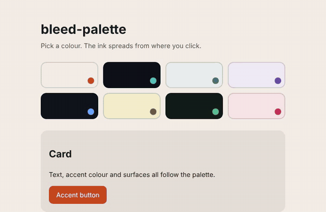

# bleed-palette

[English](README.md) · **한국어**

팔레트에서 색을 고르면 클릭한 지점에서 **잉크가 번지듯** 화면이 새 색으로 바뀌게 해 주는 라이브러리입니다. 의존성이 없고, 파일 하나로 쓸 수 있으며, 유리 효과가 있는 사이트에서도 없는 사이트에서도 동작합니다.



[View Transitions API](https://developer.mozilla.org/ko/docs/Web/API/View_Transition_API)를 사용합니다. 이전 화면과 새 화면을 브라우저가 직접 찍어 주기 때문에 유리 카드(`backdrop-filter`), 그라데이션, 이미지 배경도 정확하게 보입니다. 잉크 모양(덩어리, 촉수, 방울, 가장자리 색)은 시드 값으로 JS가 계산합니다.

잉크가 번지는 테마 전환이라는 아이디어에서 영감을 받았지만, 이 라이브러리는 처음부터 새로 작성했고 다른 프로젝트의 코드를 포함하지 않습니다.

## 설치

둘 중 하나를 고르세요.

```html
<!-- 일반 스크립트: window.BleedPalette 가 생깁니다 -->
<script src="dist/bleed-palette.js"></script>
```

```js
// ES 모듈 / 번들러 (전역 변수를 만들지 않습니다). TypeScript 타입이 들어 있습니다.
import BleedPalette, { run, cancel, pointFrom } from 'bleed-palette';
```

`dist/` 폴더에는 `bleed-palette.js`(스크립트), `bleed-palette.mjs`(ES 모듈), `bleed-palette.d.ts`(타입)가 들어 있습니다. npm으로 받아 쓰려면 직접 `npm publish`로 배포하셔야 합니다. 이 저장소가 대신 배포해 주지는 않습니다.

## 사용법

색을 적용하는 코드를 `run`으로 감싸면 됩니다.

```js
swatch.addEventListener('click', (e) => {
  const { x, y } = BleedPalette.pointFrom(e);          // 클릭한 지점 (요소를 넘기면 그 요소의 중앙)
  BleedPalette.run(() => applyPalette(palette), { x, y, color: palette.accent });
});
```

`run`은 전환이 끝나면 완료되는 Promise를 돌려줍니다. 적용 함수(`applyFn`)는 동기든 비동기든 괜찮고, 오류가 나면 `run`이 그 오류를 그대로 다시 던집니다.

| 옵션 | 기본값 | 설명 |
| --- | --- | --- |
| `x`, `y` | 화면 중앙 | 잉크가 시작되는 위치입니다 (화면 기준 CSS px). 숫자가 아닌 값이면 중앙에서 시작하고, 화면 밖의 값은 화면 안쪽으로 맞춰집니다. |
| `color` | `--ink-bleed-color`, 없으면 새 배경색에서 뽑은 색 | 번지는 가장자리에 모이는 색입니다. `#rrggbb` 형식만 받고, 그 밖의 값은 무시합니다. |
| `duration` | `1000` | 걸리는 시간입니다 (밀리초). |
| `seed` | 무작위 | 같은 값이면 같은 모양으로 번집니다. |
| `onStart`, `onEnd` | 없음 | 콜백입니다. `onStart`는 `run`이 시작될 때(`applyFn`보다 먼저), `onEnd`는 끝났을 때 한 번 호출됩니다. 정상 종료, 취소, 실패, 즉시 적용 모두 `onEnd`가 호출되고, 중간에 끊긴 이전 `run`도 자기 `onEnd`를 받습니다. 콜백에서 오류가 나면 기록만 하고 무시합니다. |
| `reducedMotion` | `'fade'` | 사용자가 "동작 줄이기"를 켜 둔 경우의 동작입니다. `'fade'`는 0.2초 크로스페이드(잉크 없음), `'none'`은 바로 적용합니다. `true`는 설정이 켜진 것처럼, `false`는 설정을 무시하고 항상 번지게 합니다. |

`BleedPalette.cancel()`은 진행 중인 전환을 끝 상태로 바로 건너뜁니다 (Promise가 완료되고 `onEnd`가 호출됩니다). `BleedPalette.supported`(또는 `isSupported()`)로 브라우저가 View Transitions를 지원하는지 알 수 있고, 지원하지 않으면 `applyFn`을 바로 실행합니다. "동작 줄이기"가 켜져 있으면 잉크 대신 짧은 크로스페이드가 나옵니다 (`reducedMotion: 'none'`이면 효과 없이 바로 바뀝니다).

## 알아 두세요

- 스와치를 누르거나 색을 확정하는 것처럼 **한 번씩 일어나는 선택**에 쓰세요. 색 선택기 안에서 드래그하는 것처럼 값이 계속 바뀌는 입력은 `input` 이벤트에서 바로 적용하거나, 데모처럼 색을 확정하는 `change` 이벤트에서 한 번만 번지게 하세요. `input`마다 번짐을 돌리면 느려집니다.
- 이미 자기 `view-transition-name`을 가진 요소는 잉크로 드러나지 않고 브라우저 기본 크로스페이드로 바뀝니다 (잉크는 페이지 전체에만 적용됩니다). 팔레트를 바꾸는 동안에는 그런 이름을 쓰지 않거나, `run`이 도는 동안만 이름을 빼 두세요.
- 번짐이 진행 중일 때 `run`을 다시 부르면 이전 것은 건너뛰고, 마지막으로 고른 색이 적용됩니다.
- 엄격한 CSP(`img-src 'self' data:`, `unsafe-inline` 없음)에서도 동작합니다. 스타일은 adopted stylesheet와 CSSOM으로 적용하고, blob URL은 쓰지 않습니다.
- 지원 브라우저: `document.startViewTransition`이 있는 브라우저 (최신 Chrome/Edge, Safari 18 이상, 최신 Firefox). 다만 테스트는 Chromium에서만 했습니다. Safari, Firefox, 모바일에서는 직접 확인해 보세요.

## 개발

```bash
npm run build   # src/*.js -> dist/ (bleed-palette.js, .mjs, .d.ts)
npm test        # 모양 단위 테스트 + Chromium 브라우저 테스트 (Playwright)
```

`node scripts/record-preview.mjs`를 실행하면 데모를 다시 녹화해서 `docs/preview.gif`를 새로 만듭니다 (Playwright와 ffmpeg가 필요합니다).

`demo/index.html`을 아무 정적 서버로 열면 직접 써 볼 수 있고, 유리 효과, 그라데이션, 이미지 배경을 켜고 끄는 토글도 있습니다.

## 라이선스

MIT © 2026 hxxnn
