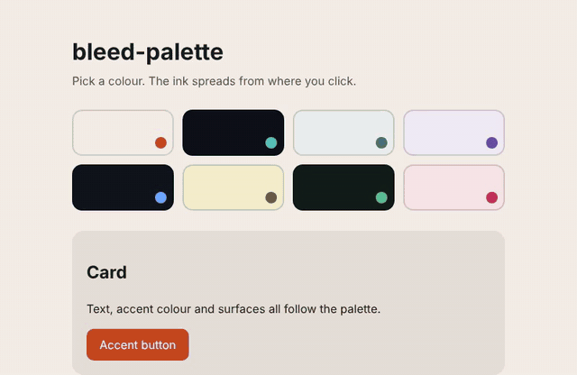

# bleed-palette

**English** · [한국어](README.ko.md)

Ink-bleed colour transitions for palette pickers. When the user picks a colour, the new look spreads from the click point like a drop of ink. No dependencies, one file, works with or without glass effects.



It is built on the [View Transitions API](https://developer.mozilla.org/docs/Web/API/View_Transition_API): the browser captures the old and new page itself, so glass cards (`backdrop-filter`), gradients and image backgrounds render correctly. The ink shape (blob, tendrils, droplets, coloured rim) is generated in JS from a seed.

Inspired by the idea of ink-spread theme switches. This library is written from scratch and contains no code from other projects.

## Install

Pick one:

```html
<!-- plain script: adds window.BleedPalette -->
<script src="dist/bleed-palette.js"></script>
```

```js
// ES module / bundler (no global is created). TypeScript types are included.
import BleedPalette, { run, cancel, pointFrom } from 'bleed-palette';
```

`dist/` contains `bleed-palette.js` (script), `bleed-palette.mjs` (ES module) and `bleed-palette.d.ts` (types). To use it from npm, publish the package yourself (`npm publish`); nothing here does that for you.

## Install as a Claude Code plugin

If you use [Claude Code](https://code.claude.com), you can install bleed-palette as a plugin. It adds a skill that copies the library into your project and wires it into your palette picker for you:

```
/plugin marketplace add hxxnn/ink-theme
/plugin install bleed-palette@hxxnn-plugins
```

On Claude Code 2.1.275 or later this also works in one step: `/plugin install bleed-palette --marketplace hxxnn/ink-theme`.

Then ask Claude, for example "add the ink bleed transition to my theme picker", or run `/bleed-palette:add-to-site`. The plugin does not run on your website; it only helps Claude add `bleed-palette.js` to your code, and the site keeps working without the plugin installed. The marketplace is this repository (`.claude-plugin/marketplace.json`), so it must be reachable by whoever adds it (public, or accessible with their GitHub login).

## Use

Wrap whatever code applies your colours:

```js
swatch.addEventListener('click', (e) => {
  const { x, y } = BleedPalette.pointFrom(e);          // click point, or pass an element
  BleedPalette.run(() => applyPalette(palette), { x, y, color: palette.accent });
});
```

`run` returns a Promise that resolves when the transition has finished. `applyFn` may be sync or async; if it throws, the error is rethrown from `run`.

| Option | Default | Meaning |
| --- | --- | --- |
| `x`, `y` | viewport centre | Where the ink starts (viewport CSS px). Invalid values fall back to the centre; values outside the viewport are clamped. |
| `color` | `--ink-bleed-color`, else a shade of the new background | Colour of the rim that pools at the front. Must be `#rrggbb`; anything else is ignored. |
| `duration` | `1000` | Milliseconds. |
| `seed` | random | Same seed, same shape. |
| `onStart`, `onEnd` | none | Callbacks. `onStart` runs as `run` begins (before `applyFn`); `onEnd` runs once when the run is over: finished, cancelled, failed, or applied at once. An interrupted run still gets its own `onEnd`. A callback that throws is logged and ignored. |
| `reducedMotion` | `'fade'` | What to do when the user prefers reduced motion: `'fade'` (a 0.2 s crossfade, no ink) or `'none'` (apply at once). `true` behaves like the preference is on; `false` ignores it and always bleeds. |

`BleedPalette.cancel()` jumps the running transition to its end state (the promise resolves and `onEnd` fires). `BleedPalette.supported` (or `isSupported()`) tells you whether the browser has View Transitions. Without it, `applyFn` just runs immediately. With "reduce motion" on, the ink is replaced by a short crossfade (or nothing, with `reducedMotion: 'none'`).

## Good to know

- Use it for discrete choices (clicking a swatch, confirming a colour). For continuous input such as dragging inside a colour picker, apply colours directly on `input`, or run the ink once on `change` (when the colour is confirmed) as the demo does; animating every `input` event would be slow.
- Elements that already have their own `view-transition-name` keep the browser's default cross-fade instead of being revealed by the ink (only the page root is). Avoid named elements during a palette change, or remove the name while `run` is active.
- A new `run` during a running transition skips the old one; the last colour wins.
- Works under a strict CSP (`img-src 'self' data:`, no `unsafe-inline`): styles are applied through adopted stylesheets and CSSOM, and no blob URLs are used.
- Browsers: those with `document.startViewTransition` (current Chrome/Edge, Safari 18+, recent Firefox). Only Chromium has been tested so far; please check Safari, Firefox and mobile yourself.

## Develop

```bash
npm run build   # src/*.js -> dist/ (bleed-palette.js, .mjs, .d.ts)
npm test        # shape unit tests + Chromium browser tests (Playwright)
```

`node scripts/record-preview.mjs` re-records `docs/preview.gif` from the demo (needs Playwright and ffmpeg).

Open `demo/index.html` through any static server to try it, with toggles for glass, gradient and image backgrounds.

## License

MIT © 2026 hxxnn
